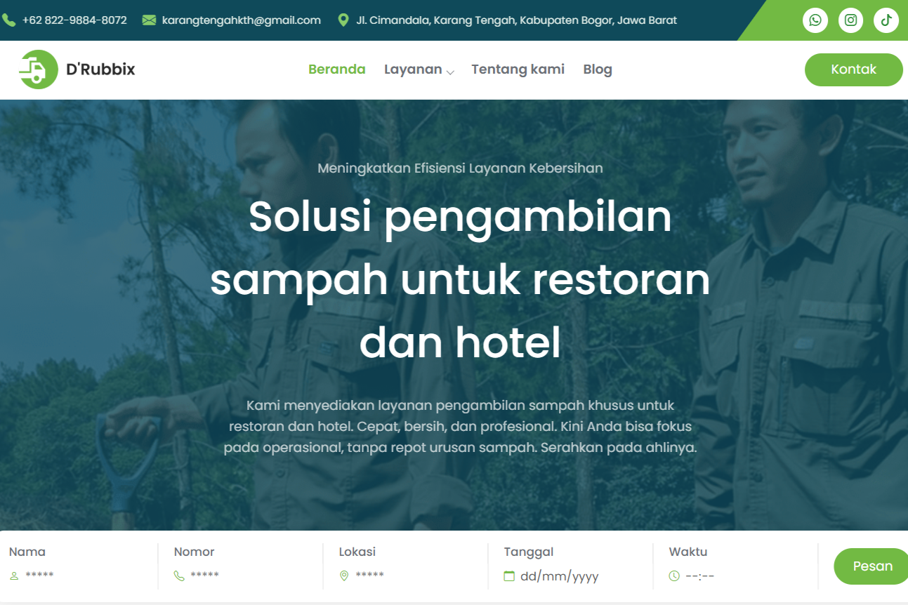

# Drubbix.id

Drubbix website featuring waste collection services, maggot products, and waste management articles.

**Status:** Live · [Visit website](https://drubbix.id/)

## Preview

[](docs/screenshots/project-preview.png)

## Features

- Waste collection service information
- Maggot product pages
- Educational articles and company profile

## Technology

HTML, CSS, JavaScript.

## Running Locally

Start an HTTP server from the project directory, then open `beranda.html`. For example, using the PHP installation bundled with XAMPP:

```sh
php -S localhost:8000
```

Open [localhost:8000](http://localhost:8000).

## Repository Notes

Installed dependencies, caches, `.env` files, databases, and user uploads are not included. Brand names and third-party assets remain subject to their respective owners' rights. This repository does not grant a license for reuse.
